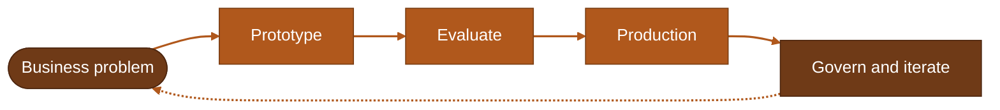

<picture>
  <source media="(prefers-color-scheme: dark)" srcset="assets/banner-dark.svg">
  
</picture>

**Building agentic and GenAI systems, from cloud to edge.**

[Website](https://micheleventimiglia.it) &nbsp;◆&nbsp; [LinkedIn](https://linkedin.com/in/michele-ventimiglia)

[Now](#now) &nbsp;·&nbsp; [How I work](#how-i-work) &nbsp;·&nbsp; [Experience](#experience) &nbsp;·&nbsp; [Projects](#projects) &nbsp;·&nbsp; [Toolbox](#toolbox) &nbsp;·&nbsp; [Background](#background)

 

> [!TIP]
> Working on agents, LLM systems or AI governance and want to compare notes? LinkedIn is the best way to reach me.

## Now

<table>
<tr>
<td valign="top" width="50%">

**At work** 
Senior AI Engineer at **PwC Italy**: delivering agentic AI projects, leading project teams and working with clients from requirements to delivery. Research on physical AI.

</td>
<td valign="top" width="50%">

**Around it** 
Finishing an **MSc in AI for Science & Technology**. Outside work: travel, food, and retrocomputing at the Ctrl+Alt Museum in Pavia.

</td>
</tr>
</table>

## How I work

I help organizations find where AI creates real value, then design the solution end to end, from the first prototype to production, with compliance in mind (I am also a certified ISO/IEC 42001 and 27001 lead auditor).

## Experience

<b>PwC Italy</b> &nbsp;·&nbsp; Senior AI Engineer &nbsp;·&nbsp; 2026 to now

 

- Designing and delivering agentic AI projects
- Leading project-based teams of engineers and consultants across client engagements
- Direct client work, from requirements gathering to delivery
- Research on physical AI

<b>IDA Italia</b> <i>(startup)</i> &nbsp;·&nbsp; Chief AI Officer &nbsp;·&nbsp; 2025 to 2026

 

- Led the AI infrastructure meant to simplify and scale Italian export
- Coordinated IT and AI teams in adopting AI across business processes
- Automation, compliance, logistics and data-driven processes for Made in Italy

<b>Integrated Risk Centre</b> &nbsp;·&nbsp; AI Consultant &nbsp;·&nbsp; 2023 to 2026

 

- Helped organizations identify where to apply AI and designed tailored solutions
- Built GenAI services (semantic search, document classification) into enterprise workflows
- FastAPI microservices in Docker for scalable deployment

<b>Freelance</b> &nbsp;·&nbsp; AI Engineer &nbsp;·&nbsp; 2023 to 2026

 

- RAG knowledge systems on LLM APIs and vector stores for semantic document retrieval
- Agentic pipelines automating business intelligence workflows for SME clients
- Python backends for AI features such as document classification and workflow automation

<b>Coherency</b> &nbsp;·&nbsp; AI Engineer for Robotics (intern) &nbsp;·&nbsp; 2024

 

- Computer vision and RAG on a Unitree Go2 robot, for autonomous security and guidance use

## Projects

Most of my work lives in private client repositories, so this page is the portfolio.

| | Project | What it does |
| :-: | --- | --- |
| 🏛️ | **Capitolium** | Matching and autocompletion for EU tenders: vector search to pair companies with the most relevant tenders, agents to complete the documents. *Transferred to a company as a product.* |
| 🤖 | **Robotic Museum Guide** | Audio-visual RAG on a Unitree Go2 so the robot can talk with museum visitors. |
| 🧬 | **Clinical Trials Search Engine** | Domain-specific retrieval system for clinical trials. |

## Toolbox

**AI and GenAI** 
`LLMs` `Agentic AI` `RAG` `LangChain` `LangGraph` `Ollama` `Transformers` `Computer vision` `Reinforcement learning`

**Engineering** 
`Python` `SQL` `FastAPI` `PyTorch` `PostgreSQL` `Docker` `AWS` `Azure` `CI/CD` `Linux`

**Automation** 
`n8n` `Workflow automation`

## Background

<b>Education and certifications</b>

 

- **MSc in Artificial Intelligence for Science & Technology** (2024 to now) and **BSc in Artificial Intelligence** (2021 to 2024), University of Pavia, University of Milan, University of Milano-Bicocca
- Certified Partner Specialist: Gemini Enterprise Deployment (Google Cloud)
- Lead Auditor ISO/IEC 42001 (AI management systems) and ISO/IEC 27001 (information security); Auditor ISO 22301 (business continuity)
- English C1

<b>Talks and awards</b>

 

- Invited speaker, *"AI for Technical Standards & Risk Management"*, Ctrl+Alt Museum, Pavia (Jun 2025)
- Invited speaker, *"AI & Human-Centred Tradition in SMEs"*, Vigevano (Oct 2024)
- Best Innovative Startup, Techstars Startup Weekend Pavia (Oct 2024)

<b>Community</b>

 

- Activators Pavia, innovation and startup community
- comPVter, which runs the Ctrl+Alt Museum, a retrocomputing museum in Pavia
- Il Cibernetico, electronic magazine: board member and author
- Former Student Union President and student representative, University of Pavia
- OpenStreetMap contributor

 

━━━━━━━━━━ &nbsp;◆&nbsp; ━━━━━━━━━━ 
Milan, Italy &nbsp;·&nbsp; Updated October 2026

