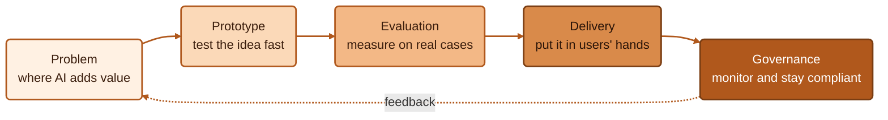

<picture>
  <source media="(prefers-color-scheme: dark)" srcset="assets/banner-dark.svg">
  
</picture>

I am a Senior AI Engineer at PwC Italy, based in Milan. I design and deliver agentic AI and LLM systems for clients, lead project teams, and do research on physical AI.

## From problem to production

How a project usually goes. Compliance work (I am a lead auditor for ISO/IEC 42001 and 27001) mostly sits in the last step.

## Experience

| | |
| --- | --- |
| 2026-now | **PwC Italy**, Senior AI Engineer Agentic AI projects, team leadership and direct client work, research on physical AI. |
| 2025-2026 | **IDA Italia** (startup), Chief AI Officer AI infrastructure to simplify and scale Italian export, coordinating IT and AI teams. |
| 2023-2026 | **Integrated Risk Centre**, AI Consultant GenAI services for enterprise workflows: semantic search and document classification. |
| 2023-2026 | **Freelance**, AI Engineer RAG knowledge systems and agentic pipelines for SME clients. |
| 2024 | **Coherency**, AI Engineer for Robotics (intern) Computer vision and RAG on a Unitree Go2 robot. |

## Selected work

Most of my work is in private client repositories, so this page is the portfolio.

| Project | What it does |
| --- | --- |
| Capitolium | Matching and autocompletion for EU tenders. Vector search pairs companies with the most relevant tenders and agents complete the documents. Transferred to a company as a product. |
| Robotic Museum Guide | Audio-visual RAG on a Unitree Go2 so the robot can talk with museum visitors. |
| Clinical Trials Search Engine | Domain-specific retrieval system for clinical trials. |

## Stack

**AI and GenAI** 
       

**Languages and data** 
    

**Backend, cloud, automation** 
      

## Background

| | |
| --- | --- |
| **Education** | MSc in Artificial Intelligence for Science & Technology (since 2024) BSc in Artificial Intelligence (2021-2024) University of Pavia, University of Milan, University of Milano-Bicocca |
| **Certifications** | Gemini Enterprise Deployment, Certified Partner Specialist (Google Cloud) Lead Auditor ISO/IEC 42001 and 27001, Auditor ISO 22301 English C1 |
| **Talks and awards** | "AI for Technical Standards & Risk Management", Ctrl+Alt Museum, Pavia (Jun 2025) "AI & Human-Centred Tradition in SMEs", Vigevano (Oct 2024) Best Innovative Startup, Techstars Startup Weekend Pavia (Oct 2024) |
| **Community** | Activators Pavia, comPVter and the Ctrl+Alt retrocomputing museum, Il Cibernetico (board member and author), OpenStreetMap contributor. Former Student Union President and student representative, University of Pavia. |
